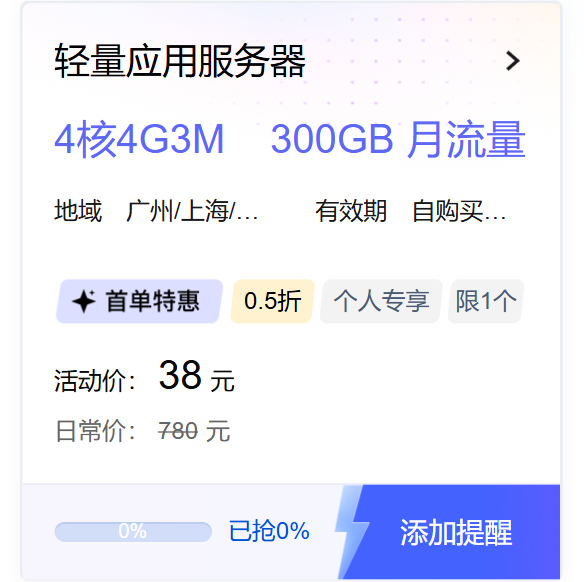

# 腾讯云服务器抢购助手

[](https://www.python.org/)
[](LICENSE)

腾讯云「上云精选·限时秒杀」轻量应用服务器（38 元/年，4 核 4G 3M）自动下单工具。

活动开始时手动点「立即抢购」常常下不了单。本工具不点页面，直接在页面里调 `do-goods` 接口，Cookie 和 CSRF Token 由浏览器自己带。



活动页：https://cloud.tencent.com/act/pro/double11-202611#MS

> 活动页的 slug 每期会变（`featured-202607` → `double11-202611` → …）。页面地址变了只需要改 `seckill.py` 顶部的 `ACTIVITY_URL` 一行；活动 id 与商品 id 由程序运行时自动获取，不需要手改。

> **遇到问题请带上日志开 issue。** 把 `seckill.log` 或控制台输出整段贴上来——里面有时序、对时偏移和每一个返回码。只说「没抢到」没法判断是时间窗、账号资格、限流还是商品 id 过期；有日志一眼就能看出来。抢到了也欢迎贴一份，可以用来对比不同参数下的表现。

## 环境准备

需要 Python 3.10 或更高版本，并装好依赖：

```bash
pip install -r requirements.txt
```

该命令只装 Python 包，不下载浏览器。本机有 Chrome 或 Edge 就直接用（日志里会写 `使用浏览器: 本机 Chrome`）。两个都没有才需要装 Chromium，见 Q3。

## 使用方法

双击 `腾讯云服务器抢购助手.bat` 启动。它会自己找本机的 Python（venv → PATH → py 启动器 → 安装目录，逐个验证版本），找不到会打印安装指引，不需要手动配路径。

控制台菜单：

| 选项 | 说明 |
| --- | --- |
| [1] 切换地域 | 上海 / 北京 / 广州 |
| [2] 扫码登录 | 弹出浏览器窗口，扫码后自动保存登录态 |
| [3] 开始抢购 | 自动等待最近一场活动 |
| [4] 选择场次 | 指定 10:00 或 15:00 |
| [5] 测试下单流程 | 用 109 元专区商品真下单、不付款；测完取消订单，不要反复测 |

抢购成功后订单保留 1 小时，需在此期间前往腾讯云控制台完成付款，逾期订单自动关闭。

## 工作原理

**整体流程**　一次抢购从点菜单到出结果是这样走的：

1. **确认登录**　读 `.state.json` 里的登录态，调 `/dianshi/check-login` 验一遍；过期就让你重新扫码。
2. **加载活动页**　打开活动页，脚本在页面里挂一个钩子，把前端自己算出来的 CSRF token 抓下来（token 是动态生成的，没法离线拼）。
3. **对时**　调 `/dianshi/get-now` 拿服务器毫秒，采样 7 次、按往返时延折半修正，取往返最快的那次作为偏移（详见下条）。
4. **现查商品 id**　从页面 HTML 取 `activity_id`，调 `query-seckill-by-date` 拿今天最近的场次和商品，再用 `query-price` 校验价格对不对（详见「商品 id 现查」）。
5. **等**　挂到开抢前 3 分钟：刷新页面、复验登录、重新对时、再查一遍商品（活动方可能临时改配置）。
6. **预热**　开抢前 20 秒发一个 `preview=1` 的预检请求，把连接建好，同时确认资格。已经售罄或资格不满足就直接中止，不白等。
7. **最后 15 秒纯等待**　一次网络请求都不发，避免把提前量吃掉。
8. **开抢**　提前 2 秒进入发送阶段：前段每 200ms 一条探针，最后 0.6 秒全速铺开，见「请求发送」。
9. **出结果**　读到 `0` 就停下并打印订单号；读到售罄或资格类致命码立刻停手；都没读到就等这场窗口跑满 10 秒。最后打一行各码次数，方便判断卡在哪。

**时间校准**　调 `/dianshi/get-now` 拿服务器毫秒，按往返时延折半修正，采样 7 次取**往返最快的那次**（网络抖动只会让往返变慢，最快的那个最接近真实值；和它相差 20ms 以内的取中位数）。本机实测偏差在 ±20ms 内——对比用 HTTP `Date` 头的老做法是 −720ms。开抢前 3 分钟再校一次，开始抢的时刻按新偏移换算成本机时间。本机时钟本身准不准无所谓：我实测的两台机器分别差 0.97 秒和 2.1 秒，程序自己会把这段补上。

**CSRF Token**　由前端动态生成，无法静态读取。脚本注入 hook 拦截页面 fetch 与 XHR 请求，从真实请求中提取。

**商品 id 现查**　腾讯每换一期活动都会换 `activity_id` 和 `act_id`，写死就会返回 `1101001 秒杀尚未开始`。程序启动时和开抢前 3 分钟各调一次 `query-seckill-by-date` 拿当天的场次表，再对场次里的每个商品调 `query-price`，按两个独立条件判定：

- `type`（即 `sales[].product_name`）等于 `lighthouse_v5`
- 价格 `real_cost` 等于 3800 分（38 元，日常价 78000 分）

两个都对上最优先；只剩 `type` 或只剩价格也能选中；`goods_name` 含「轻量」是最后一道参考。选中依据会写进日志（`price_check`），例如「type=lighthouse_v5 + 价格对上 38 元」。注意 `goods_param.type` 是 `bundle_budget_mc_lg4_01`，那是规格包编号，跟商品类型不是一回事。`activity_id` 先从活动页 HTML 里读，读不到再试 `CANDIDATE_ACTIVITY_IDS`；全失败才用写死的 id，日志会打「自动发现失败」。

**请求发送**　按服务器时间开始抢，持续 10 秒。不是一批发完再发一批：同时最多发 `INFLIGHT = 30` 条，回来一个补一个，所以每秒能发多少只看服务端回来得多快，跟单条请求慢不慢无关——旧做法一批发完等一批，单条 2 秒时只有 5 次/秒。每隔 40ms 看一次页面里攒下的返回码，读到 `0` 或致命码就停手。数字压得低是因为这个接口对突发很敏感，issue 里的日志显示活动还没开始就能收到 `408`，少发一点更稳。每秒条数大致是「这个上限 ÷ 单条耗时」，服务端一慢，发得自然就慢下来。

窗口由服务端时钟判定，所以提前量分两段：默认提前 2 秒（`ADVANCE_MS = -2000`），前面每 200ms 发一条探针（`PROBE_MS`），**最后 0.6 秒（`PRE_OPEN_FIRE_MS`）才全速铺开**。为什么要留这 0.6 秒：请求从本机到腾讯要时间（往返 70~300ms），对时本身也有 ±20ms 误差，如果等估算的开窗时刻才发第一条，落到服务端已经晚了 100ms 以上，而名额常常 1 秒内就没了。留出这 0.6 秒，第一批请求正好压在开窗那一刻到达——实测单程 250ms 时，开窗后最早一条到达只晚 33ms，而不是晚 250ms。再往前的请求只会拿到 `1101001`，白打还占限流额度，所以不铺开。

接口带 `anti_brush_version=v3`，如果日志里几乎只剩限流码、见不到别的码，把 `ADVANCE_MS` 改成 `-1000` 再试；反过来如果经常发现「我发的请求都比别人晚」，把 `PRE_OPEN_FIRE_MS` 加到 1000。

## 返回码

| code | 含义 | 该怎么办 |
| --- | --- | --- |
| `0` | 成功，已生成订单 | 1 小时内去控制台付款 |
| `1101001` | 秒杀尚未开始（不在本场时间窗内） | 正常，等场次开始；若整场只报它则说明商品 id 过期 |
| `1100106` | 相同实名主体已购买此产品，不满足首单条件 | 账号状态问题，换账号才有首单资格 |
| `1100107` | 不满足活动参与条件 | 看活动规则（新用户/企业认证等） |
| `1100109` | 商品可选参数不对 | 提交 issue 附日志 |
| `408` | 访问频率过快 | 开抢瞬间的正常现象，程序继续 |
| `1100205` | 系统繁忙 | 开抢瞬间服务端排队，程序继续 |
| `1100110` | 正在执行其他操作 | 同账号有单在提交，程序继续 |
| `1100136` | 当前商品已售罄 | 本场名额已经没了，程序会停，等下一场 |
| `-1` | 请求没发出去（网络断了或页面上下文没了） | 偶尔几条正常；如果整场都是它，检查网络或重开程序 |
| `NOT-LOGINED` 等非数字码 | 登录态失效 | 程序会停，重新扫码登录再来 |

`408` / `1100205` / `1100110` 和 `1101001` 是开抢那几秒的排队信号：一组并发请求会拿到不同的码，有的排队有的成功，同一种码程序只打印一条，不影响继续抢。`1100136` 不一样，它代表这一场的名额已经被抢光（实测最快的一次是开窗后 0.6 秒），继续发只是白撞限流，所以程序直接停手。

`1100106` / `1100107` / `1100109` 重试没用，程序会直接停掉本场。

跑完之后还会打一行各码次数，比如 `408×180, 1100205×90, 1100136×30`。这行是用来判断你到底卡在哪的：`408` 占大头说明被限流挡了，得把 `INFLIGHT` 再调低；`1100205` 占大头说明在正常排队、纯拼名额；出现 `1100136` 就是名额没了，早点收工。只看「未抢到」三个字分不出这几种情况。

## 测试下单流程（[5]）

用「服务器专区」的 109 元商品走一次 `preview=0` 的真实下单，不付款。它和 38 元那款配置相同，但不是同一个商品，所以试它不会动到秒杀那款。能确认这几件事：

- 登录态是否有效
- `goods_param` 参数结构是否正确
- 首单资格与账号状态（返回 `1100106` 说明这个实名主体已经有过首单商品）
- 建单与风控放行（这一步只有 `preview=0` 才会真的走）

**为什么不拿 38 元那款试**：秒杀商品只在 10:00–12:00 / 15:00–18:00 之间能下单，窗口外只会返回 `1101001`，测不到东西。专区商品不受时间窗限制。

**测完要做什么**：不付款的订单 1 小时后自动关闭，不扣钱。抢购前去订单页把它取消掉。

**不要反复测**：短时间反复建单会触发风控。有人被限制到第二天才能正常抢。只在改动过下单相关代码之后测一次，平时不用测。

## 文件说明

| 文件 | 说明 |
| --- | --- |
| `腾讯云服务器抢购助手.bat` | 一键启动入口 |
| `seckill_ui.py` | 控制台菜单与交互 |
| `seckill.py` | 对时、CSRF 捕获与下单逻辑 |
| `requirements.txt` | Python 依赖 |
| `.state.json` | 登录态，扫码后自动生成，不在版本库里 |
| `config.json` | 地域配置，首次运行后自动生成，不在版本库里 |

## 常见问题

**Q1：提示「未捕获到 CSRF token」**

活动页结构可能已调整，hook 无法取得 Token。可检查 `seckill.py` 中的 `CSRF_HOOK_JS`，或提交 issue 并附上页面截图。

**Q2：更换浏览器会影响登录吗？**

不会。Cookie 从 `.state.json` 读取，经 `new_context(storage_state=...)` 载入一个全新的隔离上下文，不涉及本机日常浏览器的用户数据。

**Q3：提示浏览器无法启动**

本机未检测到 Chrome 或 Edge，执行 `python -m playwright install chromium` 后重试。

**Q4：订单未付款**

订单保留 1 小时，请前往控制台付款或手动取消。

**Q5：一直返回 `1101001 秒杀尚未开始`，是不是坏了？**

分两种情况。在 10:00–12:00 / 15:00–18:00 之间还报这个码，说明商品 id 过期了（腾讯换了活动）。程序会自动现查；如果日志里出现「自动发现失败」，说明活动页地址也变了，改 `ACTIVITY_URL`。

**Q6：`1100106` 是不是程序出错？**

不是。这条是腾讯侧的业务规则：同一实名主体只能享受一次「首单特惠」，与程序无关。同一商品族（`p_lighthouse` / `sp_lighthouse_bundle_budget_mc`）内买过任意一款，其它款的首单资格也会一起用掉。

**Q7：这一期活动结束后还能用吗？**

活动 id 会过期，程序不依赖写死的 id：只要能打开活动页、`query-seckill-by-date` 与 `query-price` 还能调，就能继续用。[3]/[4] 启动时会现查当天场次。腾讯换了新活动页（slug 变了）就把 `ACTIVITY_URL` 改成新地址，必要时再把新 `activity_id` 加进 `CANDIDATE_ACTIVITY_IDS`。

## 免责声明

本工具仅供个人学习与研究使用。自动化抢购可能违反腾讯云活动规则，导致账号限流或功能受限，相关风险由使用者自行承担，请勿用于高频滥用。

## License

MIT