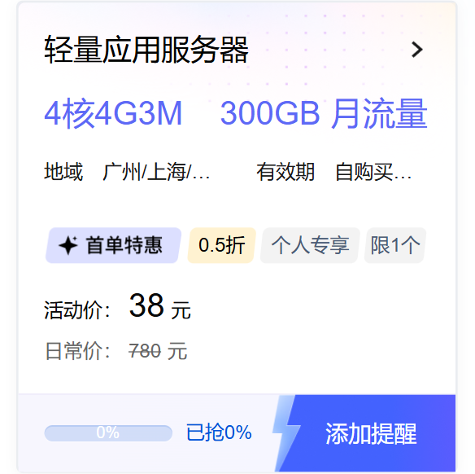

# 腾讯云服务器抢购助手

[](https://www.python.org/)
[](LICENSE)

腾讯云「上云精选·限时秒杀」轻量应用服务器（38 元/年，4 核 4G 3M）自动下单工具。

活动开始时手动点击「立即抢购」通常无法下单。本工具跳过 DOM 操作，直接在页面上下文内调用 `do-goods` 接口，Cookie 与 CSRF Token 均交由浏览器处理。



活动页：https://cloud.tencent.com/act/pro/double11-202611#MS

> 活动页的 slug 每期会变（`featured-202607` → `double11-202611` → …）。页面地址变了只需要改 `seckill.py` 顶部的 `ACTIVITY_URL` 一行；活动 id 与商品 id 由程序运行时自动获取，不需要手改。

## 环境准备

需要 Python 3.10 或更高版本。

```bash
pip install -r requirements.txt
```

该命令仅安装 Python 依赖包，不会下载浏览器。本机已安装 Chrome 或 Edge 时脚本会直接复用，运行日志中会出现 `使用浏览器: 本机 Chrome`。两者均未安装时，需要额外下载一份 Chromium：

```bash
python -m playwright install chromium
```

## 使用方法

双击 `腾讯云服务器抢购助手.bat` 启动，或在命令行执行：

```bash
python seckill_ui.py
```

控制台菜单：

| 选项 | 说明 |
| --- | --- |
| [1] 切换地域 | 上海 / 北京 / 广州 |
| [2] 扫码登录 | 弹出浏览器窗口，扫码后自动保存登录态 |
| [3] 开始抢购 | 自动等待最近一场活动 |
| [4] 选择场次 | 指定 10:00 或 15:00 |
| [5] 测试连通 | 校验登录态，不下单 |
| [6] 试单 | `preview=1` 走真实校验流程，不创建订单、不扣费 |

抢购成功后订单保留 1 小时，需在此期间前往腾讯云控制台完成付款，逾期订单自动关闭。

也可跳过菜单，直接指定场次运行：

```bash
python seckill.py --time 15:00
python seckill.py --test        # 试单，preview=1，不会下单
```

## 工作原理

**时间校准**　读取响应头 Date 字段，采样 7 次取中位数，误差约 ±0.1 秒，开抢前 3 分钟再次校准。

**CSRF Token**　由前端动态生成，无法静态读取。脚本注入 hook 拦截页面 fetch 与 XHR 请求，从真实请求中提取。

**商品 id 现查**　腾讯每换一期活动都会换 `activity_id` 与 `act_id`，写死在代码里必然过期，表现为返回 `1101001 秒杀尚未开始`。程序启动与开抢前 3 分钟都会调用 `query-seckill-by-date` 接口，按日期现查当前在售场次与轻量商品 id；查不到才回落到代码里的兜底值。

**请求发送**　按服务器时间开火，10 并发、间隔 20ms，持续 10 秒。服务端以自己的时钟判定秒杀窗口，提前发送只会拿到 `1101001`，因此默认不提前。

**登录态校验**　使用 `get-vip-info` 接口，该接口不产生订单，可安全重复调用。

## 返回码

| code | 含义 | 该怎么办 |
| --- | --- | --- |
| `0` | 成功，已生成订单 | 1 小时内去控制台付款 |
| `1101001` | 秒杀尚未开始（不在本场时间窗内） | 正常，等场次开始；若一直报则说明商品 id 过期 |
| `1100106` | 相同实名主体已购买此产品，不满足首单条件 | 账号状态问题，换账号才有首单资格 |
| `1100107` | 不满足活动参与条件 | 看活动规则（新用户/企业认证等） |
| `1100109` | 商品可选参数不对 | 提交 issue 附日志 |

`1100106` / `1100107` / `1100109` 属于重试也没用的错误，程序会立刻停止本场，不会白刷。

## 文件说明

| 文件 | 说明 |
| --- | --- |
| `腾讯云服务器抢购助手.bat` | 一键启动入口 |
| `seckill_ui.py` | 控制台菜单与交互 |
| `seckill.py` | 对时、CSRF 捕获与下单逻辑 |
| `requirements.txt` | Python 依赖 |
| `.state.json` | 登录态，扫码后自动生成，不在版本库里 |
| `config.json` | 地域配置，首次运行后自动生成，不在版本库里 |

## 常见问题

**Q1：提示「未捕获到 CSRF token」**

活动页结构可能已调整，hook 无法取得 Token。可检查 `seckill.py` 中的 `CSRF_HOOK_JS`，或提交 issue 并附上页面截图。

**Q2：更换浏览器会影响登录吗？**

不会。Cookie 从 `.state.json` 读取，经 `new_context(storage_state=...)` 载入一个全新的隔离上下文，不涉及本机日常浏览器的用户数据。

**Q3：提示浏览器无法启动**

本机未检测到 Chrome 或 Edge，执行 `python -m playwright install chromium` 后重试。

**Q4：订单未付款**

订单保留 1 小时，请前往控制台付款或手动取消。

**Q5：一直返回 `1101001 秒杀尚未开始`，是不是坏了？**

分两种情况。在 10:00–12:00 / 15:00–18:00 窗口内仍报这个码，说明商品 id 已过期（腾讯换活动了）。程序会自动现查，正常情况不需要你动手；若日志里出现「自动发现失败」，说明活动页地址也变了，改 `ACTIVITY_URL` 即可。

**Q6：`1100106` 是不是程序出错？**

不是。这条是腾讯侧的业务规则：同一实名主体只能享受一次「首单特惠」，与程序无关。同一商品族（`p_lighthouse` / `sp_lighthouse_bundle_budget_mc`）内买过任意一款，其它款的首单资格也会一起用掉。

**Q7：这一期活动结束后还能用吗？**

活动 id 会过期，但程序不依赖写死的 id：页面还在、接口还在就能继续用。[3]/[4] 启动时会现查当天场次；如果腾讯换成新的活动页（slug 变化），把 `ACTIVITY_URL` 改成新地址，必要时把新 `activity_id` 加进 `CANDIDATE_ACTIVITY_IDS` 兜底列表。

## 免责声明

本工具仅供个人学习与研究使用。自动化抢购可能违反腾讯云活动规则，导致账号限流或功能受限，相关风险由使用者自行承担，请勿用于高频滥用。

## License

MIT